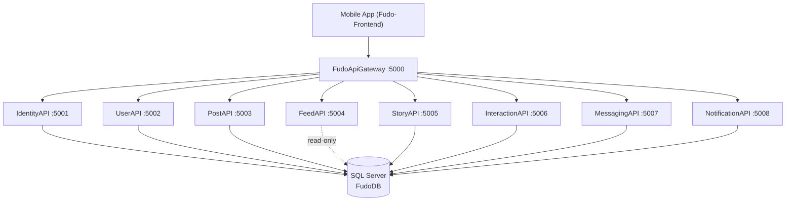
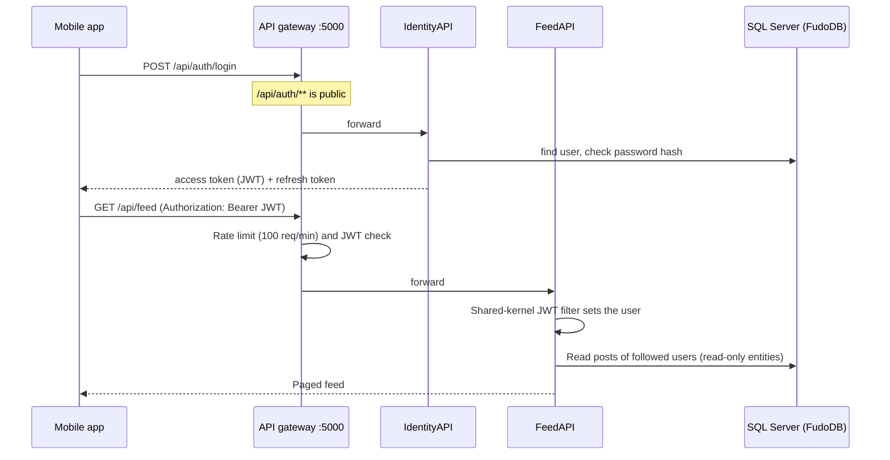

<div align="center">

# Fudo: Backend Microservices

**A Java 17 / Spring Boot 3 microservices backend for a recipe-sharing social network**

Eight independently deployable services sit behind a Spring Cloud Gateway, each owning its own slice of
the domain (identity, users, posts, feed, stories, interactions, messaging, notifications), on a shared
SQL Server database. It is a faithful port of an original .NET 9 microservices solution: same routes,
same business rules, same entity model, reimplemented in Java and Spring.


[Mobile app repo](https://github.com/QaisRjoob/Fudo-Frontend) ·
[Architecture](#architecture) ·
[Services](#services) ·
[Request flow](#request-flow) ·
[Database](#database) ·
[Getting started](#getting-started)

</div>

---

## Table of contents

1. [Architecture](#architecture)
2. [Services](#services)
3. [Request flow](#request-flow)
4. [Tech stack](#tech-stack)
5. [Database](#database)
6. [Getting started](#getting-started)
7. [Notable deviations from the .NET original](#notable-deviations-from-the-net-original)
8. [Layout](#layout)

---

## Architecture



Every service depends on **FudoSharedKernel**, a plain Maven library (not a Spring Boot app) providing exceptions, pagination helpers, integration events, a lightweight CQRS mediator (replaces MediatR), and the shared JWT validation filter/security infra.

## Services

| Service | Port | Responsibility |
|---|---|---|
| **FudoApiGateway** | 5000 | Spring Cloud Gateway edge router — single entry point, JWT validation, rate limiting |
| **IdentityAPI** | 5001 | Registration, login, JWT issuance, refresh tokens |
| **UserAPI** | 5002 | User profiles, follow/unfollow relationships |
| **PostAPI** | 5003 | Recipe posts — media, tags, ingredients, steps |
| **FeedAPI** | 5004 | Read-only feed aggregation over Post/User data (owns no tables of its own) |
| **StoryAPI** | 5005 | 24-hour stories, replies, views, highlights |
| **InteractionAPI** | 5006 | Comments, likes, saves on posts |
| **MessagingAPI** | 5007 | 1:1 and group conversations, messages (STOMP over WebSocket) |
| **NotificationAPI** | 5008 | User notifications |

Individual services are also exposed on their original ports for direct access/debugging, but the gateway (`:5000`) is the intended single entry point.

## Request flow

Signing in, then reading the feed through the gateway:



The gateway routes by path prefix: `/api/auth/**` to IdentityAPI, `/api/users/**` to UserAPI,
`/api/posts/**` to PostAPI, `/api/feed/**` to FeedAPI, `/api/stories/**` to StoryAPI,
`/api/interactions/**` to InteractionAPI, `/api/messaging/**` and `/hubs/**` to MessagingAPI, and
`/api/notifications/**` to NotificationAPI.

## Tech stack

- **Java 17**, **Spring Boot 3.3.4**
- **Spring Cloud Gateway** (routing), **Spring Security** + **JJWT** (auth)
- **Spring Data JPA** / Hibernate, **SQL Server** (single shared `FudoDB` database)
- **springdoc-openapi** (Swagger UI per service), **Lombok**
- **JUnit 5** + **Mockito** + **H2** (unit/integration tests), **Docker Compose**

## Database

All 8 services share one **SQL Server** database (`FudoDB`), mirroring the original .NET design — each service owns a subset of tables, but there's a single physical schema rather than one database per service. `FeedAPI` owns no tables at all; it maps read-only JPA entities directly onto `PostAPI`'s and `UserAPI`'s tables (`ddl-auto=validate`).

```mermaid
erDiagram
    USERS ||--o| USER_PROFILES : "1:1"
    USERS ||--o{ REFRESH_TOKENS : issues
    USERS ||--o{ FOLLOWS : "follows / is followed"
    USERS ||--o{ POSTS : authors
    USERS ||--o{ POST_COMMENTS : writes
    USERS ||--o{ POST_LIKES : likes
    USERS ||--o{ POST_SAVES : saves
    USERS ||--o{ STORIES : authors
    USERS ||--o{ STORY_HIGHLIGHTS : owns
    USERS ||--o{ STORY_REPLIES : sends
    USERS ||--o{ STORY_VIEWS : views
    USERS ||--o{ CONVERSATION_PARTICIPANTS : joins
    USERS ||--o{ MESSAGES : sends
    USERS ||--o{ NOTIFICATIONS : receives

    POSTS ||--o{ POST_MEDIA : has
    POSTS ||--o{ POST_TAGS : has
    POSTS ||--o{ POST_INGREDIENTS : has
    POSTS ||--o{ POST_STEPS : has
    POSTS ||--o{ POST_COMMENTS : has
    POSTS ||--o{ POST_LIKES : has
    POSTS ||--o{ POST_SAVES : has

    POST_COMMENTS ||--o{ POST_COMMENTS : "replies to"

    STORIES ||--o{ STORY_REPLIES : has
    STORIES ||--o{ STORY_VIEWS : has

    CONVERSATIONS ||--o{ CONVERSATION_PARTICIPANTS : has
    CONVERSATIONS ||--o{ MESSAGES : has

    USERS {
        uuid id PK
        string email
        string username
        boolean isAdmin
    }
    USER_PROFILES {
        uuid id PK "same id as USERS"
        int followerCount
        int followingCount
        int postCount
    }
    REFRESH_TOKENS {
        uuid id PK
        uuid userId FK
        string token
        boolean isRevoked
    }
    FOLLOWS {
        uuid id PK
        uuid followerId FK
        uuid followeeId FK
    }
    POSTS {
        uuid id PK
        uuid authorId FK
        string title
        boolean isPublished
    }
    POST_MEDIA {
        uuid id PK
        uuid postId FK
        string url
    }
    POST_TAGS {
        uuid id PK
        uuid postId FK
        string tag
    }
    POST_INGREDIENTS {
        uuid id PK
        uuid postId FK
        string name
    }
    POST_STEPS {
        uuid id PK
        uuid postId FK
        int stepNumber
    }
    POST_COMMENTS {
        uuid id PK
        uuid postId FK
        uuid authorId FK
        uuid parentCommentId FK "nullable, self-ref"
    }
    POST_LIKES {
        uuid id PK
        uuid postId FK
        uuid userId FK
    }
    POST_SAVES {
        uuid id PK
        uuid postId FK
        uuid userId FK
    }
    STORIES {
        uuid id PK
        uuid authorId FK
        instant expiresAt
    }
    STORY_HIGHLIGHTS {
        uuid id PK
        uuid ownerId FK
        string storyIds "CSV of Story ids, not an enforced FK"
    }
    STORY_REPLIES {
        uuid id PK
        uuid storyId FK
        uuid senderId FK
    }
    STORY_VIEWS {
        uuid id PK
        uuid storyId FK
        uuid viewerId FK
    }
    CONVERSATIONS {
        uuid id PK
        boolean isGroup
    }
    CONVERSATION_PARTICIPANTS {
        uuid id PK
        uuid conversationId FK
        uuid userId FK
    }
    MESSAGES {
        uuid id PK
        uuid conversationId FK
        uuid senderId FK
    }
    NOTIFICATIONS {
        uuid id PK
        uuid recipientId FK
        uuid actorId FK "nullable"
        string type
    }
```



Cross-service foreign keys (e.g. `PostAPI.posts.author_id` → `IdentityAPI.users.id`) are plain UUID columns, not DB-level `FOREIGN KEY` constraints — each service treats the others' tables as owned by that service, matching the original per-service repository boundaries even though they physically live in one database.

## Getting started

### Docker Compose (recommended)

```bash
docker compose up --build
```

This brings up SQL Server, all 8 services, and the gateway. First run downloads ~2GB of base images and does 9 cold Maven builds inside the containers — no local Maven/JDK required.

### Building locally

A portable Maven 3.9.9 + JDK 17 toolchain isn't assumed to be on your PATH; if you don't have Maven installed, `tools/apache-maven-3.9.9` has one (not tracked in this repo — see `.gitignore`). Otherwise, with your own Maven:

```bash
cd FudoSharedKernel && mvn install
cd ../IdentityAPI && mvn package    # repeat per service
```

The shared kernel must be `mvn install`-ed first — every service depends on it as `com.fudo:fudo-shared-kernel:1.0.0` from your local `~/.m2` repo.

Every service has been individually verified with `mvn test` (JUnit 5 + Mockito unit tests + an H2-backed `@SpringBootTest` context-load smoke test) and `mvn package` (produces a runnable fat jar).

## Notable deviations from the .NET original

- **Auth**: SQL Server `Trusted_Connection=True` (Windows integrated auth) → SQL auth (`sa` / configurable), since integrated auth doesn't translate to Linux containers.
- **MessagingAPI**: SignalR Hub + Redis backplane → STOMP-over-WebSocket with Spring's in-memory `SimpleBroker` (single-instance; swap to `enableStompBrokerRelay` against a STOMP-capable broker for horizontal scaling). SignalR's `JoinConversation`/`LeaveConversation` RPCs have no equivalent because STOMP `SUBSCRIBE`/`UNSUBSCRIBE` to `/topic/conversations/{id}` already is the join/leave. `SendTyping`'s "others in group" exclusion isn't replicated — the server broadcasts to everyone subscribed including the sender; client should filter out its own `userId`.
- **Gateway**: the original ran 2 static dev instances per service behind round-robin (`localhost:500X`/`501X`); the Docker topology runs one container per service, so the gateway routes directly to each service's container instead of recreating fake multi-instance load balancing. Rate limiting (100 req/min) is an in-memory fixed-window filter rather than `RedisRateLimiter` — fine for one gateway instance, would need Redis-backing for more.
- **Cross-service DB coupling preserved as-is**: PostAPI issues a native `UPDATE user_profiles SET post_count = post_count + ?` directly against UserAPI's table (same shared database) — this mirrors the original's raw SQL against the single shared `FudoDB`, not something introduced by the port. FeedAPI similarly maps read-only JPA entities directly onto PostAPI's/UserAPI's tables (`ddl-auto=validate`, never creates/alters them).
- **Several "dead" integration points were ported as-is, not fixed**: the 5 integration event classes (`UserRegisteredEvent`, `PostCreatedEvent`, etc.) and `EventPublisher`/RabbitMQ plumbing exist in the shared kernel but aren't called from any handler — the original C# handlers never published them either. Likewise UserAPI's `POST /internal/create-profile` endpoint exists but nothing calls it from IdentityAPI's register flow, exactly as in the source. If you want real event-driven wiring between services, that's new work, not a missed conversion detail.
- **JSON wire format**: Lombok generates `isActive()`-style getters for `boolean isActive` fields, but Jackson's bean introspection strips the `is` prefix when deriving the JSON key (`isActive()` → `"active"`), which would silently rename fields like `isActive`/`isAdmin`/`isGroup`/`isLiked`/`isSaved`/`isPrivate`/`isRead`/`isViewed`/`isFollowing`/`isOwnProfile` relative to the original C# camelCase contract. Every response DTO with such a field has an explicit `@JsonProperty("isXxx")` override to preserve the original wire format exactly.

## Layout

- `FudoSharedKernel` — shared library (entities, mediator, JWT filter, pagination).
- `IdentityAPI`, `UserAPI`, `PostAPI`, `FeedAPI`, `StoryAPI`, `InteractionAPI`, `MessagingAPI`, `NotificationAPI` — the 8 resource services.
- `FudoApiGateway` — Spring Cloud Gateway edge router.
- `docker-compose.yml` — SQL Server + all 9 services wired together.

Every service mirrors the same internal structure: `entity/` (JPA), `interfaces/` + `infrastructure/repository/` (repository abstraction), `application/dto/command|query/`, `features/handler/command|query/` (CQRS handlers via the shared `Mediator`), `controller/`, `config/`.
